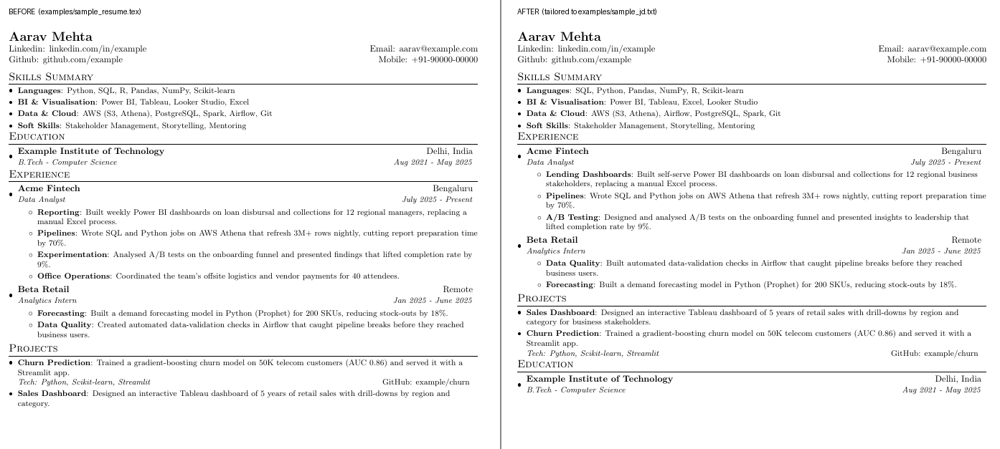
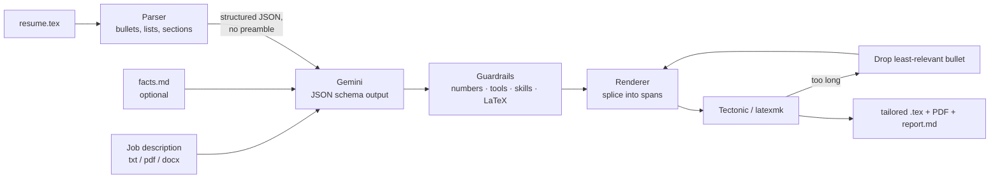

# tailortex

**Tailor a LaTeX resume to any job description in one command — without the AI inventing anything.**

Paste a job description, get back a compile-checked, one-page `.tex` + PDF whose bullets speak the JD's language, plus a report of exactly what changed and why. Powered by Google Gemini (free tier works). CLI and Streamlit web app.



## Why this is different from "paste your resume into ChatGPT"

Asking an LLM to rewrite a whole `.tex` file breaks in three predictable ways: it **mangles your template**, it **invents skills and metrics** to match the JD, and the result **spills onto page two**. tailortex is built around preventing all three:

| Problem | How tailortex handles it |
|---|---|
| Broken LaTeX | The model never sees or writes the `.tex` file. A parser cuts out each bullet with exact character spans; edits are spliced back into those spans only. Rendering with no edits is **byte-identical** to the input (tested). |
| Fabrication | Every edit passes guardrails: no new numbers, no JD tools you never mention, no new skills in the Skills section, no unknown LaTeX commands. Violations are discarded and listed in the report. |
| Page overflow | After compiling, it drops the least-relevant bullets one at a time until the PDF fits `--max-pages`. |
| A bad edit that won't compile | Edits are re-applied one by one; only the offending bullet is reverted. |
| "What did it change?" | `report.md`: keyword coverage before → after, every bullet before/after, blocked edits with reasons, and the JD requirements you genuinely lack. |

## How it works



* **Template-agnostic parser** — reads your preamble's `\newcommand`s to learn which macros are bullets (`\resumeItem`, `\resumeSubItem`, …), which open/close lists, and which are headings (anything with a `tabular`). Works out of the box with the two most popular templates (Jake's Resume and Sourabh Bajaj's) and plain `\item` lists. Run `tailortex inspect` to see exactly what it found.
* **What the model may change:** bullet text and bold labels, bullet order within a list, section order, and dropping irrelevant bullets. Header, education and layout are untouched (Education is locked by default).
* **Structured output:** Gemini returns a Pydantic-validated plan (`plan.json`) — not free text. You can hand-edit it and replay it with `--plan`.

## Quick start

```bash
git clone https://github.com/<you>/tailortex && cd tailortex
pip install -e ".[web,dev]"
cp .env.example .env          # add your free key from https://aistudio.google.com/apikey
```

You also need a LaTeX engine for PDFs. [Tectonic](https://tectonic-typesetting.github.io/en-US/install.html) is the easiest (one binary, fetches packages itself); an existing TeX Live / MiKTeX (`latexmk` or `pdflatex`) works too. Without one you still get the `.tex`.

### Try it with no API key

A saved plan is included, so you can see the whole pipeline offline:

```bash
tailortex tailor examples/sample_resume.tex --jd examples/sample_jd.txt --plan examples/sample_plan.json
```

Notice in `output/…/report.md` that the plan's attempt to claim **dbt** experience was blocked — it isn't anywhere on the sample resume.

### CLI

```bash
tailortex inspect my_resume.tex                    # what can be edited? (offline)
tailortex tailor my_resume.tex --jd job.pdf        # tailor + compile
tailortex tailor my_resume.tex --jd - < job.txt    # JD from stdin
tailortex models                                   # Gemini models your key can use
```

| Option | Default | |
|---|---|---|
| `--facts FILE` | `facts.md` | True things not on your resume the model may use ([example](facts.example.md)) |
| `--max-pages N` | `1` | Trim least-relevant bullets until it fits (`0` = off) |
| `--lock SECTION` | `Education` | Never edit this section (repeatable) |
| `--no-drop` | | Never remove bullets for relevance |
| `--keep-section-order` | | Don't move sections |
| `--model ID` | `$GEMINI_MODEL` | Falls back through `$GEMINI_FALLBACK_MODELS` if retired |
| `--engine` | auto | `tectonic`, `latexmk`, `pdflatex`, `xelatex` |
| `--plan FILE` | | Replay a saved `plan.json` instead of calling Gemini |

Output goes to `output/<date>_<company>_<role>/`: the tailored `.tex`, the PDF, `report.md`, `plan.json` and a copy of the JD.

### Web app

```bash
streamlit run app.py
```

Upload your `.tex` (or set `TAILORTEX_RESUME` in `.env`), paste or upload the JD, and get coverage metrics, a bullet-by-bullet diff, a PDF preview and downloads. Deploys as-is to Streamlit Community Cloud (`packages.txt` installs TeX Live; put `GEMINI_API_KEY` in the app's secrets).

## Guardrails in detail

An edit is **rejected** (original bullet kept) if it:

1. has unbalanced braces;
2. uses a LaTeX command your resume never uses (e.g. `\input`);
3. contains a number that isn't in that bullet or your facts file (stops "saved 10 hours/week" appearing from nowhere);
4. mentions a JD **tool** (named technology, as classified by the model) that appears nowhere in your resume or facts;
5. adds an item to your Skills section that you never listed.

New JD *phrasing* for things you did (e.g. "self-serve dashboards", "lending") is allowed but flagged in the report so you can double-check it. Unescaped `% & # _ $`, Markdown `**bold**` and smart quotes are repaired automatically.

## Project layout

```
tailortex/
  latex.py      parser, span-based renderer, plain-text conversion
  guards.py     validation + auto-repair of every edit
  engine.py     orchestration, keyword coverage, compile-and-fit loop
  llm.py        Gemini backend (JSON schema, retries, model fallback) + FakeLLM
  prompts.py    system prompt and structured user prompt
  compiler.py   tectonic / latexmk / pdflatex wrapper, page counting
  report.py     Markdown change report
  cli.py        command line
app.py          Streamlit UI
tests/          offline test suite (fake LLM; real LaTeX tests auto-skip without an engine)
```

## Tests

```bash
pytest -q
```

The suite runs fully offline with a fake LLM: parser round-trips on both templates, every guardrail, reordering/section moves, page fitting, compile-failure isolation, and real compilation when a TeX engine is present. CI runs it on every push.

## Limitations

* Keyword coverage is a transparent proxy for ATS matching, not a copy of any vendor's algorithm.
* Custom templates with very unusual macros may need a tweak — `tailortex inspect` shows whether your bullets were found and confirms the round-trip check passes.
* The LLM still writes the prose. Read the report before you send anything.

## License

MIT
